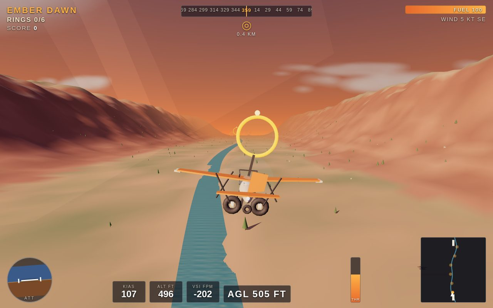

# EMBERWING II — Ember Valley

[](https://make.fun/bounty/best-flight-game-20261126-0057)
[](https://make.fun/bounty/best-flight-game-20261126-0057)
[](https://make.fun/bounty/best-flight-game-20261126-0057)

A Three.js bush-plane flight game for make.fun's "Make the best flight game"
bounty. Fly the Kestrel K-9 down a river canyon at dusk: thread the glowing
rings, mind the fuel and the wind, and put her down on the far strip.



## Play

Serve `game/` and open it in a desktop browser:

```sh
node serve.ts
# game/ is on http://localhost:8080
```

W/S throttle, arrow keys fly, Space is the brake, C changes camera
(chase / cockpit / high), P pauses, M mutes, R restarts. Hold the mouse
and drag to fly the stick. Keys 1–3 pick a sortie on the title screen.

Three sorties: **Ember Dawn** (6 rings, gentle wind), **Ridge Runner**
(10 rings, crosswind gusts), **Night Mail** (12 rings, night, thin fuel).

## What is in v2

- A real 3D cockpit: dashboard with lit gauges, windshield pillars, and
  the cowling and spinner ahead — the cockpit view is a cockpit.
- Layered rock strata, pines, boulders, and a scrolling river under the
  rings; a dusk sun with shadows, fog, clouds, and light shafts.
- A proper control tower: glass cab with mullions, a lit console inside,
  and a blinking beacon — no blue slab.
- A slim lathe fuselage that tapers to a real tail, high wing with
  struts, tundra gear, and a spinning prop.
- Ring bursts, flare callouts, PAPI and runway edge lights, wind audio,
  and a minimap with a ring arrow.

## Hand in

```sh
mkdir -p out && MAKEFUN_OUTPUT_DIR=out node main.ts
```

`main.ts` copies `game/` and `screenshots/` to `/output` and writes
`/output/dossier.json` with the kit's vendored library. Three.js r149 is
vendored under `game/vendor/three.min.js`; the game makes no network
request at runtime.
